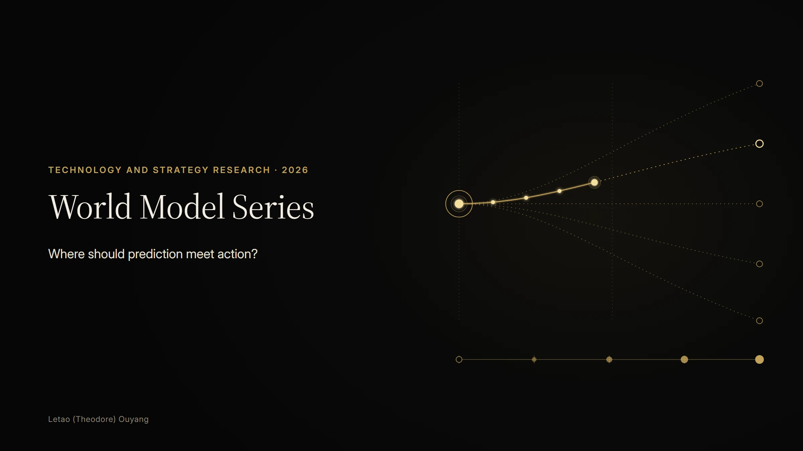
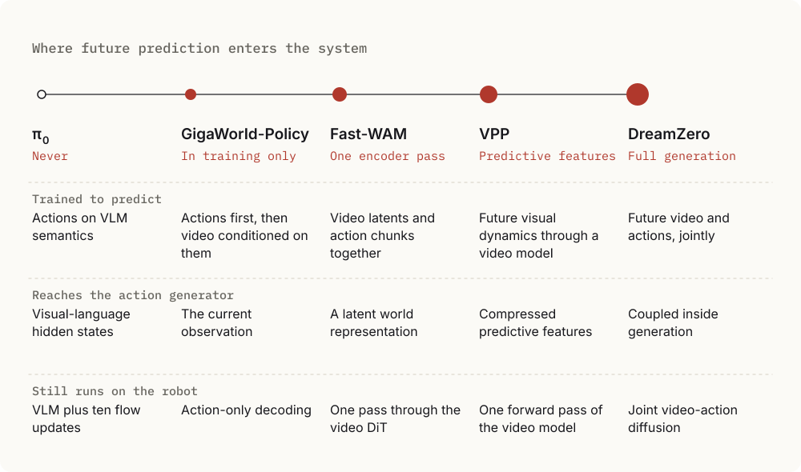
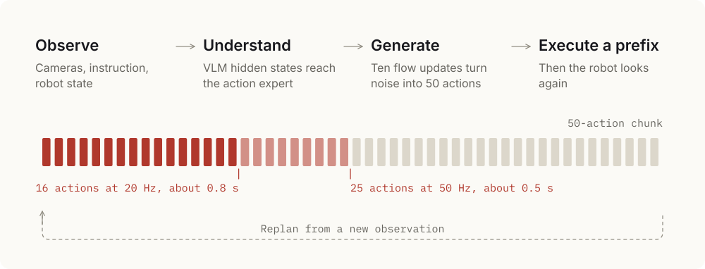
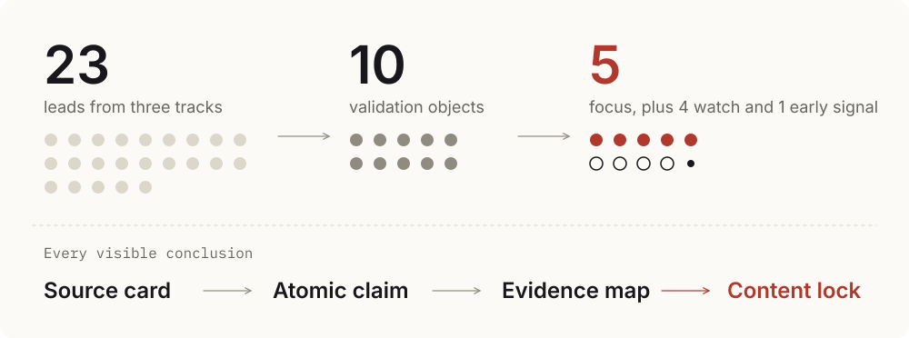
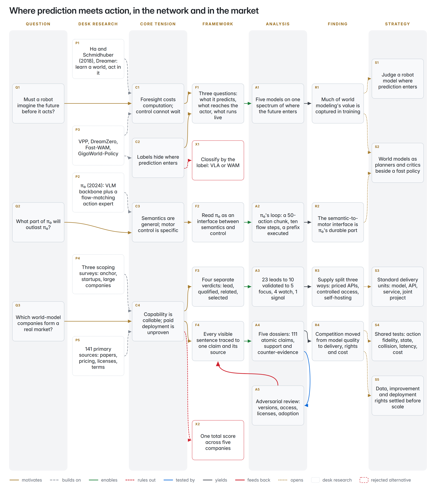

# World Model Series

**Letao (Theodore) Ouyang** · Technology and strategy research · July – August 2026 · English and Chinese editions

[Where the future enters](articles/2026-08-03-from-vision-and-instructions-to-robot-actions/README.en.md) · [π₀](research/2026-08-02-pi0-vla-flow/README.en.md) · [The overseas world-model market](research/2026-08-03-manifold-world-model-landscape/README.en.md) · [Research route](docs/research-route.md) · [Desk research](docs/desk-research.md)

**A world model is valuable because it predicts the future. A robot, and a business, are valuable only when they act in the present. Where should prediction meet action?**

That is the core tension of the field, and it appears twice. Inside the network, predicting future video carries the
densest physical signal a policy can learn from, and it is the most expensive thing a model can compute while a
robot waits for its next action. In the market, world models can be called through APIs, previews and downloads, and
customers have yet to confirm paying for them in production. The series follows the tension through three works: a
comparison that orders five robot models by **where the future enters** them, an analysis of π₀ that locates its
durable part in **the interface between semantics and control**, and a study of the overseas world-model market for
Manifold that traces **23 leads to 5 focus companies** and finds the competition has moved from model quality to
delivery, rights and cost.

## Three findings to start with

| Finding | Why it matters | Where |
| --- | --- | --- |
| Much of world modeling's value can be taken at training time and left out of deployment | Foresight and latency stop being a binary choice; the cost of prediction becomes a design decision | [Where the future enters](articles/2026-08-03-from-vision-and-instructions-to-robot-actions/README.en.md) |
| The interface that lets general semantics condition continuous control is the part of π₀ the next generation inherits | Backbones and action experts will be replaced; the seam between them is where a world model can advise a fast policy | [π₀ analysis](research/2026-08-02-pi0-vla-flow/README.en.md) |
| World-model supply has split into priced APIs, controlled access and self-hosted components, and competition has moved to delivery, rights and cost | A market that is callable and not yet bought needs delivery units, shared tests and settled rights before it needs better demos | [Market study](research/2026-08-03-manifold-world-model-landscape/README.en.md) |

## Where the future enters

"VLA" and "world-action model" name families, not mechanisms. I compare robot models with three questions instead:
what is the model trained to predict, what representation reaches the action generator, and which computations
remain active when the robot runs? The answers turn two categories into one spectrum. DreamZero generates future
video and actions jointly at inference. VPP conditions its policy on one forward pass of predictive features without
drawing the future. Fast-WAM keeps a single-pass world encoder. GigaWorld-Policy decodes actions with its video
branch switched off. π₀ never predicts the future at all.

The consequence is strategic. Learning from visual dynamics can shape a policy that generates only actions at
deployment, so latency, architecture and the value of world modeling have to be judged at the point where prediction
enters, never by the name on the paper.

## π₀: the interface is the durable part

π₀ resolves a second tension: semantic knowledge is general, while motor control is specific to a body and its
demonstrations. I follow the model from conditional flow matching to action chunks to receding-horizon execution.
Each cycle denoises a 50-step action chunk in ten Euler steps, executes a prefix of 16 actions at 20 Hz or 25 at 50
Hz, then observes again and replans. The equations explain how actions are generated; the loop explains how the
robot stays responsive. What lasts is the interface between a general semantic backbone and a continuous-control
expert, and that seam is also where world models fit best: planning and evaluating consequences beside a fast policy.

## The overseas world-model market

For Manifold, a Chinese world-model company, I mapped who outside China builds world models that act, how they are
sold and who pays. The study is built as a decision system rather than a report. It separates four verdicts that
market analysis usually collapses: worth investigating, technically qualified, strategically related, and worth one
of five presentation slots. Every visible sentence traces to one atomic claim and its sources: 141 registered
sources, 111 atomic claims, five dossiers with support and counter-evidence side by side. The five focus companies,
World Labs, Odyssey, Runway, Decart and NVIDIA Cosmos 3, are five different risk paths rather than a ranking.

The method is **meta prompting**. Before any search ran I wrote a charter of twenty sections that governs every
later instruction: hard constraints, evidence standards, one authority file per decision, a saved state, and four
gates that wait for my approval. A launch prompt of three paragraphs starts the run, because every standard of
judgment already lives in the charter. Both documents are published with the study.

Supply has split into publicly priced interfaces, application-controlled access and downloadable or self-hosted
components, and competition has moved from visual quality to APIs, runtimes, deployment, integration, data rights and
total cost. The moves that matter next are standard delivery units, shared tests for action fidelity, persistent
state, geometry and collision, latency and cost, and data, improvement and deployment rights settled before scale.

## How the series was built

<picture>
  <source media="(prefers-color-scheme: dark)" srcset="assets/route-dark.png">
  
</picture>

The route runs from question to strategy, and one review went back and changed the framework.

- **Where the future enters.** The trade between foresight and latency is decided at training, at the action
  interface and at deployment, so three questions replace two labels.
- **The durable part of π₀.** The interface resolves the tension between general semantics and specific control,
  and the execution loop shows how.
- **A market that is callable and not yet bought.** Four separate verdicts and claim-level tracing kept the study at
  its evidence. Independent review of the dossiers held pilot and hands-on wording to its sources and made the
  strategic gate an explicitly conditional comparison.

The [research route](docs/research-route.md) explains all 32 steps and all 32 links, and the
[desk research](docs/desk-research.md) sets every work against the papers and the market record it builds on.

## Repository

| Path | Contents |
| --- | --- |
| [`articles/2026-08-03-from-vision-and-instructions-to-robot-actions/`](articles/2026-08-03-from-vision-and-instructions-to-robot-actions/README.en.md) | Where the future enters: the comparison of five robot models, in English and Chinese |
| [`research/2026-08-02-pi0-vla-flow/`](research/2026-08-02-pi0-vla-flow/README.en.md) | π₀ from flow matching to the execution loop, in English and Chinese |
| [`research/2026-08-03-manifold-world-model-landscape/`](research/2026-08-03-manifold-world-model-landscape/README.en.md) | The overseas world-model market study, its source materials and presentation |
| [`docs/research-route.md`](docs/research-route.md) · [`docs/desk-research.md`](docs/desk-research.md) | The series as a network, and the desk research |

## Citation

Letao (Theodore) Ouyang, *World Model Series* (2026),
<https://github.com/130U/ENGINEERING-World-Model-Series/blob/main/articles/2026-08-03-from-vision-and-instructions-to-robot-actions/README.en.md>.
See [CITATION.cff](CITATION.cff).

[theodore.oy2025@gmail.com](mailto:theodore.oy2025@gmail.com) · [10@alumni.duke.edu](mailto:10@alumni.duke.edu)

© Letao (Theodore) Ouyang. All rights reserved.
