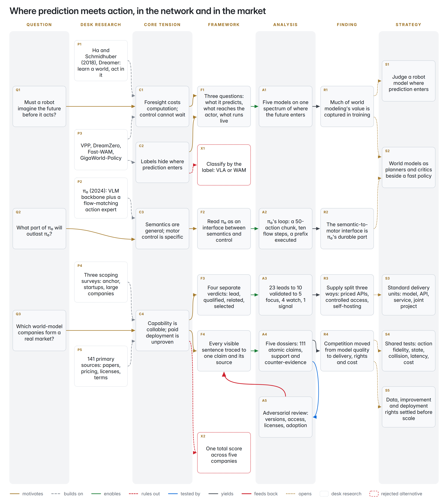

# Research route

How the series was built: which question led to which tension, what desk research each framework stands on, what
the analysis produced, and which strategic moves follow. Three works share one tension, between predicting the
future and acting in the present, and the route shows where each resolves it.

<picture>
  <source media="(prefers-color-scheme: dark)" srcset="../assets/route-dark.png">
  
</picture>

## Reading the figure

Columns run from question to strategy. A link can run between any two columns, and one runs backwards, from a review
to the framework.

| Link | Meaning |
| --- | --- |
| motivates | A question or a tension that made the next step necessary |
| builds on | Desk research the step starts from |
| enables | A framework that makes an analysis possible |
| tested by / yields | An analysis and the review that checks it; an analysis and what it found |
| feeds back | A review that changed the framework |
| rules out | A tension that excludes an approach |
| opens | A finding that leads to a strategic move |

Solid boxes are my own steps. Dotted boxes are desk research, and red dashed boxes are approaches I rejected.

## The three threads

### 1. Where the future enters a robot policy

Q1, P1, P3 → C1, C2 → F1 → A1 → R1 → S1, S2, with C2 ruling out X1.

The world-model line (P1), from Ha and Schmidhuber to Dreamer, learns how an environment changes and acts inside that
model. Four recent world-action models (P3) use future video in four different ways. Together they expose the core
tension of the field (C1): predicting future video carries the densest physical signal a policy can learn from, and
it is the most expensive thing a model can compute while a robot waits for its next action. The usual taxonomy hides
that trade, because "VLA" and "world-action model" name families rather than mechanisms (C2, X1).

I replaced the labels with three questions (F1): what is the model trained to predict, what representation reaches
the action generator, and which computations remain active when the robot runs. The answers order five models on one
spectrum (A1): DreamZero generates future video and actions jointly at inference, VPP takes one-step predictive
features without drawing the future, Fast-WAM keeps a single-pass world encoder, GigaWorld-Policy decodes actions
with its video branch switched off, and π₀ never predicts the future at all. The finding (R1) is that much of world
modeling's value can be taken at training time and left out of deployment. Two strategic moves follow: judge a robot
model at the point where prediction enters, never by its label (S1), and let world models plan and evaluate beside a
fast policy rather than sit inside its control loop (S2).

### 2. The durable part of π₀

Q2, P2 → C3 → F2 → A2 → R2 → S2.

π₀ joins a pretrained vision-language model to a continuous action expert trained with conditional flow matching
(P2). It resolves a second tension (C3): semantic knowledge is general and transfers across tasks, while motor control
is specific to a body and its demonstrations. I read the model as an interface between the two (F2) and followed it
from the flow-matching objective to the execution loop (A2): each cycle denoises a 50-step action chunk in ten Euler
steps, executes a prefix of 16 actions at 20 Hz or 25 at 50 Hz, then observes again and replans. The backbone and
the expert will both be replaced. The interface that lets general semantics condition continuous control is what the
next generation inherits (R2), and it is also where a world model can advise a fast policy without replacing it (S2).

### 3. A market that is callable and not yet bought

Q3, P4, P5 → C4 → F3, F4 → A3, A4 → A5 → R3, R4 → S3, S4, S5, with C4 ruling out X2 and A5 feeding back into F4.

For Manifold, a Chinese world-model company, the question was who outside China builds world models that act, how
they are sold, and who pays (Q3). Three scoping surveys produced 23 leads and a map of large-company routes (P4),
read as leads and reopened at 141 primary sources (P5). The tension (C4) was visible early: world models can be
called through APIs, previews and downloads, and none of the leading companies had a customer-confirmed paid
deployment.

Two frameworks kept the study honest about that. Four separate verdicts (F3) distinguish a company worth
investigating from one that is technically qualified, strategically related, and worth one of five presentation
slots. And every visible sentence traces to one atomic claim and its sources (F4). The five companies share no
hardware, task or disclosure protocol, so a single total score would have manufactured precision (X2). The funnel
(A3) ran from 23 leads to 10 validated objects to five focus objects, four watch objects and one early signal, and
the five dossiers (A4) registered 111 atomic claims with support and counter-evidence side by side.

Independent reviewers then attacked version ownership, access, licensing and every adoption statement (A5). The
review went back into the claim framework (A5 → F4): pilot and hands-on wording was held to its evidence, and the
strategic gate became an explicitly conditional comparison. Two findings came out. Supply has split into three paths:
publicly priced interfaces, application-controlled access and self-hosted components (R3). And competition has moved
from model quality to delivery, rights and cost (R4). The strategy is what a market needs before it can buy: standard
delivery units (S3), shared tests that every buyer can run (S4), and data, improvement and deployment rights settled
before scale (S5).

## Every step

| Node | Column | What it is |
| --- | --- | --- |
| **Q1** Must a robot imagine the future before it acts? | Question | Vision-language-action models act from an understanding of the present scene; world-action models learn how the scene will change. The question is how much of that foresight a deployed robot needs. |
| **Q2** What part of π₀ will outlast π₀? | Question | π₀ became the reference generalist robot policy. Models are replaced every few months; the question is which design decision carries forward. |
| **Q3** Which world-model companies form a real market? | Question | A strategy question for Manifold, a Chinese world-model company: outside China, who builds world models that act, how they are sold, and who is paying. |
| **P1** Ha and Schmidhuber (2018), Dreamer: learn a world, act in it | Desk Research | The world-model line: learn a compact model of the environment's dynamics, then train or plan a policy inside it. |
| **P3** VPP, DreamZero, Fast-WAM, GigaWorld-Policy | Desk Research | Four world-action models from 2024 to 2026 that use future video differently: joint generation, predictive features, training-only co-modeling and a causally separated video branch. |
| **P2** π₀ (2024): VLM backbone plus a flow-matching action expert | Desk Research | Physical Intelligence's generalist policy: a pretrained vision-language model and a continuous action expert trained with conditional flow matching, on cross-embodiment data. |
| **P4** Three scoping surveys: anchor, startups, large companies | Desk Research | Three broad surveys that described Manifold from public evidence, collected 23 non-China leads and mapped large-company substitution routes. They were read as leads, not as findings. |
| **P5** 141 primary sources: papers, pricing, licenses, terms | Desk Research | Official project pages, papers, repositories, model cards, price lists, licenses, terms and partner statements, each registered with a source card. |
| **C1** Foresight costs computation; control cannot wait | Core Tension | Predicting future video carries the dense physical signal a policy can learn from, and it is the most expensive thing a model can compute while a robot is waiting for its next action. |
| **C2** Labels hide where prediction enters | Core Tension | "VLA" and "world-action model" name families, not mechanisms. Two models with different labels can run the same computation at deployment, and two with the same label can differ completely. |
| **C3** Semantics are general; motor control is specific | Core Tension | Internet-scale vision-language knowledge transfers across tasks; continuous control depends on the robot's body and its demonstrations. A policy has to join the two. |
| **C4** Capability is callable; paid deployment is unproven | Core Tension | World models can be called through APIs, previews and downloads. Customer-confirmed paid production use, renewal or revenue had not appeared for any of the leading five. |
| **F1** Three questions: what it predicts, what reaches the actor, what runs live | Framework | What is the model trained to predict? What representation reaches the action generator? Which computations remain active when the robot runs? The answers place any robot model, whatever its label. |
| **X1** Classify by the label: VLA or WAM | Framework | The taxonomy most discussions use. Rejected: it sorts by name and hides the trade between foresight and latency. |
| **F2** Read π₀ as an interface between semantics and control | Framework | Follow π₀ from conditional flow matching to action chunks to receding-horizon execution, and treat the seam between the semantic backbone and the action expert as the object of study. |
| **F3** Four separate verdicts: lead, qualified, related, selected | Framework | Worth investigating, technically qualified, strategically related and worth one of five presentation slots are four different judgments. A company passes each on its own evidence. |
| **F4** Every visible sentence traced to one claim and its source | Framework | A page claim maps to an atomic claim, and an atomic claim to its sources. No source may support more than the claim it actually makes. |
| **X2** One total score across five companies | Framework | The usual landscape ranking. Rejected: the five share no hardware, task, duration, failure-rate or disclosure protocol, so a total would manufacture precision. |
| **A1** Five models on one spectrum of where the future enters | Analysis | DreamZero generates future video and actions jointly at inference; VPP takes one-step predictive features; Fast-WAM keeps a single-pass world encoder; GigaWorld-Policy decodes actions with the video branch switched off; π₀ never predicts the future. |
| **A2** π₀'s loop: a 50-action chunk, ten flow steps, a prefix executed | Analysis | Each cycle denoises a 50-step action chunk in ten Euler steps, executes a prefix of 16 actions at 20 Hz or 25 at 50 Hz, then observes again and replans. |
| **A3** 23 leads to 10 validated to 5 focus, 4 watch, 1 signal | Analysis | Category cleaning removed thirteen boundary cases before the in-depth work began. Ten objects were validated; World Labs, Odyssey, Runway, Decart and NVIDIA Cosmos 3 took the five focus slots as five different risk paths. |
| **A4** Five dossiers: 111 atomic claims, support and counter-evidence | Analysis | 58 targeted queries for supporting and contrary evidence, 141 registered sources and 111 atomic claims, with each product's components kept apart so that one could not borrow another's access status. |
| **A5** Adversarial review: versions, access, licenses, adoption | Analysis | Independent reviews attacked version ownership, commercial access and licensing, and the scope of every adoption statement. |
| **R1** Much of world modeling's value is captured in training | Finding | Fast-WAM's controlled comparisons and GigaWorld-Policy's architecture both take the physical signal of future video during training and leave iterative future generation out of deployment. |
| **R2** The semantic-to-motor interface is π₀'s durable part | Finding | The backbone and the expert will both be replaced; the interface that lets general semantics condition continuous control is what the next generation inherits. |
| **R3** Supply split three ways: priced APIs, controlled access, self-hosting | Finding | World models reach buyers as publicly priced interfaces, as application-controlled access, or as downloadable and self-hosted components. |
| **R4** Competition moved from model quality to delivery, rights and cost | Finding | The competitive unit includes APIs, runtimes, deployment, integration, data rights, licensing and total cost of ownership. |
| **S1** Judge a robot model where prediction enters | Strategy | Compare latency, architecture and the value of world modeling at the point where future prediction enters the policy, never by the name on the paper. |
| **S2** World models as planners and critics beside a fast policy | Strategy | Keep the control loop fast and let world models do what they are best at: planning and evaluating consequences. |
| **S3** Standard delivery units: model, API, service, joint project | Strategy | Define what a customer buys, so that capability can be priced, compared and renewed. |
| **S4** Shared tests: action fidelity, state, collision, latency, cost | Strategy | Build validation assets that every buyer can run: action fidelity, persistent state, geometry and collision, failure rate, latency and total cost. |
| **S5** Data, improvement and deployment rights settled before scale | Strategy | Agree input and output data rights, model-improvement rights, deployment and redistribution before commercial scale makes them expensive to change. |

## Every link

| # | From | To | Link | Why |
| ---: | --- | --- | --- | --- |
| 1 | Q1 | C1 | motivates | Whether to imagine the future is a question of what the robot can afford to compute |
| 2 | P1 | C1 | builds on | World models learn dynamics and plan inside them, and planning takes time |
| 3 | P3 | C1 | builds on | The four models pay for foresight in four different places |
| 4 | P3 | C2 | builds on | Models with one label run very different computations at deployment |
| 5 | Q2 | C3 | motivates | What lasts is whatever resolves the tension the model was built around |
| 6 | P2 | C3 | builds on | π₀ joins a general semantic backbone to a continuous action expert |
| 7 | Q3 | C4 | motivates | A market exists where capability is bought, not where it is announced |
| 8 | P4 | C4 | builds on | The surveys showed broad activity and very little evidence of buyers |
| 9 | P5 | C4 | builds on | Prices, terms and partner statements show how capability is offered, and who confirms it is used |
| 10 | C1 | F1 | motivates | The trade between foresight and latency is decided at training, at the action interface and at deployment |
| 11 | C2 | F1 | motivates | Questions about mechanism replace questions about names |
| 12 | C2 | X1 | rules out | A label cannot say what runs on the robot |
| 13 | C3 | F2 | motivates | The interface is where the tension is resolved, so it is what to study |
| 14 | C4 | F3 | motivates | Interest, qualification, relevance and selection are different claims about an unproven market |
| 15 | C4 | F4 | motivates | When adoption is unproven, every sentence has to carry its evidence |
| 16 | C4 | X2 | rules out | Capability and adoption are reported on incompatible terms |
| 17 | F1 | A1 | enables | The three questions turn two categories into one ordered spectrum |
| 18 | F2 | A2 | enables | Following the execution loop shows how the interface keeps the robot responsive |
| 19 | F3 | A3 | enables | Each gate removes a different failure before the next one starts |
| 20 | F4 | A4 | enables | Dossiers are built claim by claim, with counter-evidence beside support |
| 21 | A4 | A5 | tested by | Every dossier faced reviewers looking for version drift and overstatement |
| 22 | A1 | R1 | yields | Designs that drop future generation at deployment keep its training signal |
| 23 | A2 | R2 | yields | The loop works because the interface turns semantics into executable chunks |
| 24 | A3 | R3 | yields | The five focus objects fall into three ways of reaching a buyer |
| 25 | A4 | R4 | yields | Access, licensing and deployment terms differ more than demonstrations do |
| 26 | A5 | F4 | feeds back | The review held pilot and hands-on wording to its evidence and made the strategic gate an explicitly conditional comparison |
| 27 | R1 | S1 | opens | If value can be taken in training, the deployment cost is a design choice and should be judged as one |
| 28 | R1 | S2 | opens | Foresight belongs where time allows it: in training, planning and evaluation |
| 29 | R2 | S2 | opens | A clean interface lets a world model advise a fast policy without replacing it |
| 30 | R3 | S3 | opens | Three supply paths need one definition of what is sold |
| 31 | R4 | S4 | opens | Buyers need shared tests to compare what they cannot see in a demo |
| 32 | R4 | S5 | opens | Rights are part of the product once delivery is the competition |
