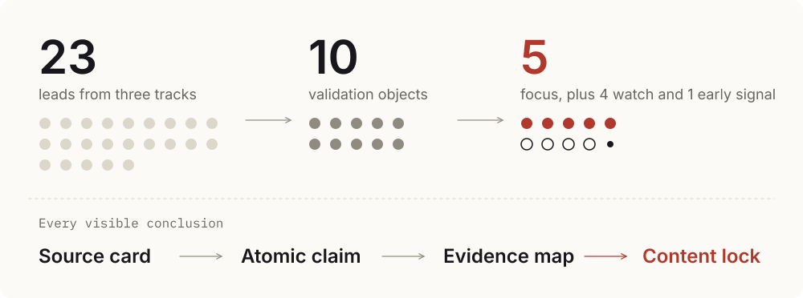
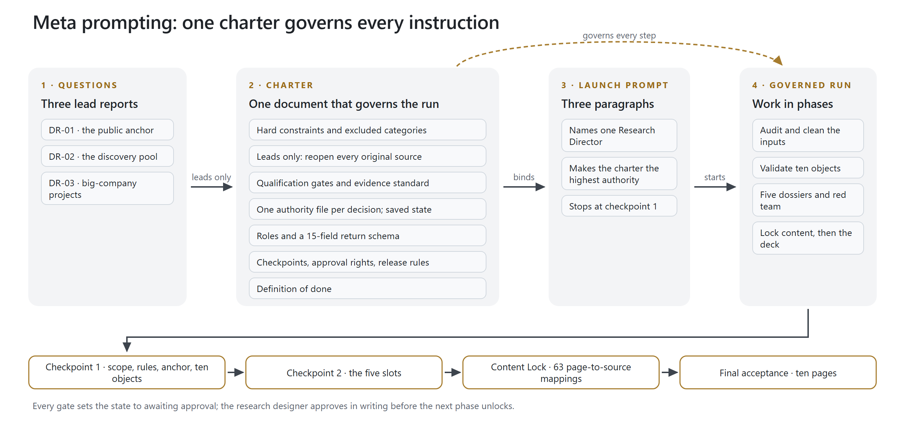

# Manifold and the Overseas World-Model Landscape

> A market study built as a decision system: three research questions, one charter, four approval gates, and a trace from every sentence to its source.\
> Paired version: [中文](./README.zh-CN.md)\
> Research cutoff: July 14, 2026 · Focus companies: World Labs, Odyssey, Runway, Decart and NVIDIA Cosmos 3\
> Materials: [ten-page deck](source-snapshot/archive/manifold-world-model-landscape/10_deck/manifold_world_model_landscape_v1_4.pptx) · [five dossiers](source-snapshot/archive/manifold-world-model-landscape/06_dossiers/) · [evidence ledger](source-snapshot/archive/manifold-world-model-landscape/04_evidence/evidence_ledger.csv) · [charter](source-snapshot/archive/manifold-world-model-landscape/01_inputs/governance/Manifold_World_Model_Research_Project_Plan_v2.0_CN.md) · [launch prompt](source-snapshot/archive/manifold-world-model-landscape/01_inputs/governance/Manifold_ChatGPT_Work_Launch_Prompt_v2.0_CN.md)

**Who outside China builds world models that act, how are they sold, and who pays?** For Manifold, a Chinese world-model company, I answered with independent desk research on public sources. The method is meta prompting: before any search ran, I wrote the charter that governs every later instruction, so that scope, evidence standards and approvals were decided once and applied to every object in the same way.

---

<a id="en-quick-take" data-pair-id="quick-take"></a>
## 1. The Study in One Minute

<a id="en-quick-take-market" data-pair-id="quick-take-market"></a>
### 1.1 What the market looks like

1. **Supply has split into three delivery paths:** publicly priced interfaces, application-controlled access, and downloadable or self-hosted components.
2. **The five focus companies are five risk paths, and they are complementary.** World Labs stands for spatial-world products, Odyssey for real-time world streams, Runway for a content platform extending into Worlds and Robotics, Decart for a driving-first priced API, and NVIDIA Cosmos 3 for self-hosted components.
3. **Callable comes before bought.** As of July 14, 2026, the strongest public evidence for all five is vendor-hosted prototypes, partner-reported tests, priced supply paths and downloadable model materials. Customer-first-party confirmation of paid production use, renewal or revenue is the next evidence level, and it is the event that reopens the analysis.
4. **Manifold is the public comparison anchor.** Every statement about substitution or competition is conditional on Manifold's public WorldScape record.
5. **The next move is validation and rights infrastructure:** standard delivery units; shared tests for action fidelity, persistent state, geometry and collision, failure rate, latency and total cost of ownership; and data, model-improvement, deployment and redistribution rights settled in advance.

<a id="en-quick-take-numbers" data-pair-id="quick-take-numbers"></a>
### 1.2 What makes the study checkable

**Table 1. The study in counts, from leads to page-evidence mappings.**

| Stage | Count |
| --- | --- |
| Leads registered from the discovery report | 23 |
| Objects validated one by one | 10 |
| Focus companies, watch objects, early signal | 5, 4 and 1 |
| Registered sources, each with a source card | 141 |
| Atomic claims in the evidence ledger | 111 |
| Targeted queries for the dossiers, 28 supporting and 30 disconfirming | 58 |
| Page-to-claim-to-source mappings behind the ten-page deck | 63 |
| Monitoring signals for the five, and triggers for the watch objects | 17 and 5 |

<p align="center"></p>

<a id="en-meta-prompting" data-pair-id="meta-prompting"></a>
## 2. Method: Meta Prompting

<a id="en-meta-prompting-what" data-pair-id="meta-prompting-what"></a>
### 2.1 A prompt about how prompts will run

An ordinary prompt asks a model for an answer. A meta prompt decides how answers will be produced: what may be searched, what counts as evidence, which file is authoritative, when work must stop, and who approves the next step. I wrote that document first. The research question arrives only after the rules that will judge its answers are fixed.

<picture>
  <source media="(prefers-color-scheme: dark)" srcset="../../assets/meta-prompting-dark.png">
  
</picture>

<a id="en-meta-prompting-layers" data-pair-id="meta-prompting-layers"></a>
### 2.2 Three layers

**Table 2. The three layers of the meta prompt.**

| Layer | Document | What it does |
| --- | --- | --- |
| Questions | DR-01, DR-02, DR-03 | Three questions that check one another: Manifold's public anchor, the non-China discovery pool, and big-company projects with their substitution routes. The three Deep Research reports are leads |
| Charter | [Project plan](source-snapshot/archive/manifold-world-model-landscape/01_inputs/governance/Manifold_World_Model_Research_Project_Plan_v2.0_CN.md) | Twenty sections that fix constraints, ingestion rules, gates, evidence standards, authority files, state and recovery, roles, checkpoints, release conditions and the definition of done |
| Launch prompt | [Launch prompt](source-snapshot/archive/manifold-world-model-landscape/01_inputs/governance/Manifold_ChatGPT_Work_Launch_Prompt_v2.0_CN.md) | Three paragraphs: it names one Research Director, makes the charter the highest authority, restates the hard constraints and stops the run at checkpoint 1 |

The launch prompt can be three paragraphs long because every standard of judgment already lives in the charter. A new session, or a run resumed after an interruption, reads the same charter and the same state file and continues from the last completed step.

<a id="en-meta-prompting-charter" data-pair-id="meta-prompting-charter"></a>
### 2.3 What the charter fixes

**Table 3. What the charter fixes, and what each clause secures.**

| Clause | Content | What it secures |
| --- | --- | --- |
| Hard constraints | A deck of at most ten pages; five slots, three or four startups and one or two big-company projects; Manifold as anchor only; six excluded categories | The scope stays the one I approved |
| Ingestion rules | The three reports are lead memos; any claim that drives eligibility, the five slots or a key number is reopened at its original source | Facts rest on primary sources |
| Authority files | One authoritative file per decision domain; CSV and Markdown outrank their XLSX and PPTX derivatives | One set of facts |
| State and recovery | A state file records phase, status, next action and approved checkpoints; every resumption reads it first; silence is never approval | Progress is a field in a file |
| Roles and return schema | One lead and at most three parallel roles; only the lead writes authority files; every role returns the same 15 fields, with evidence, counter-evidence and unknowns | Parallel results can be merged and compared field by field |
| Checkpoints and decision rights | Two research checkpoints, Content Lock and final acceptance; proposer and approver are listed separately, and approval is mine | Judgment sets the pace |
| Release conditions | A red team on three lines; major findings close before content is locked | Every visible sentence survives an attack |
| Definition of done | Approved five, traceable claims, facts separated from inference, approved Content Lock, a deck within ten pages | Completion is objective |

<a id="en-meta-prompting-why" data-pair-id="meta-prompting-why"></a>
### 2.4 Why it works

- **Judgment moves to the front.** Gates, evidence thresholds and wording ceilings are written before the first search, so the tenth object meets the same standard as the first.
- **Stopping is executable.** A checkpoint turns "may continue" into a field of the state file; the approval is written back first, and only then does downstream work unlock.
- **Outputs can be merged.** A shared return schema lets parallel research be compared field by field, and conflicts surface at the merge.
- **The trade-offs stay with me.** I approve scope, the five slots and the public wording. The tools widen coverage, recover sources and repeat the mechanical checks.

Used this way, research tools become instruments inside a system that can pause, be audited, and be rerun by someone else from the same five input files.

<a id="en-research-origin" data-pair-id="research-origin"></a>
## 3. Three Questions before One Search

I split the opening work into three Deep Research questions that constrain one another. I designed the three questions, what each one had to settle, and how its report could be used afterwards.

**Table 4. The three lead reports and the decisions they lead to.**

| Report | What it contributes | The decision it leads to |
| --- | --- | --- |
| [DR-01](<source-snapshot/archive/manifold-world-model-landscape/01_inputs/deep_research/DR-01 Manifold 公开比较锚点.md>) · Manifold's public anchor | The dimensions on which overseas objects can be compared with Manifold | Manifold enters the study as a public comparison anchor, built from its public record |
| [DR-02](<source-snapshot/archive/manifold-world-model-landscape/01_inputs/deep_research/DR-02 非中国玩家发现池与三层漏斗.md>) · the non-China discovery pool | 23 registered leads, well beyond the best-known names | Eligibility cleaning comes before company research, because "world model" means different things in video, robotics, simulation and spatial intelligence |
| [DR-03](<source-snapshot/archive/manifold-world-model-landscape/01_inputs/deep_research/DR-03 大厂项目 平台替代与垂直替代路线.md>) · big-company projects and substitution routes | The bypass routes that large companies build from open components or full-stack platforms | Only specific big-company world-model projects qualify; VLA systems, simulation platforms and internal components are recorded as boundaries |

All three reports serve as leads. Every claim that decides scope, eligibility or a conclusion is reopened at its original public source.

<a id="en-decision-trail" data-pair-id="decision-trail"></a>
## 4. From 23 Leads to Five Slots

<a id="en-governance-first" data-pair-id="governance-first"></a>
### 4.1 Authority and state come first

The run begins by creating a machine-readable [state file](source-snapshot/archive/manifold-world-model-landscape/00_brief/project_state.json), a [decision log](source-snapshot/archive/manifold-world-model-landscape/00_brief/decision_log.md) and an [input manifest](source-snapshot/archive/manifold-world-model-landscape/01_inputs/input_manifest.csv). The five inputs, three reports and two governance files, are fixed with their size, date and SHA-256. My later red-team notes and approvals enter the same register. From this point every disagreement between sources has a place where it is settled and a person who settles it.

<a id="en-split-audit" data-pair-id="split-audit"></a>
### 4.2 Three separate input audits

The Manifold anchor, the discovery pool and the big-company routes are audited separately, and their findings are reconciled under one standard. The 23 DR-02 entries become **nine validation inputs, thirteen boundary exclusions and one discarded entry**, recorded in the [eligibility register](source-snapshot/archive/manifold-world-model-landscape/03_universe/eligibility_register.csv). Most of the early work is the removal of category contamination before any deep research is spent.

<a id="en-qualification" data-pair-id="qualification"></a>
### 4.3 What counts as a world model

A vendor's use of the phrase does not qualify an object. Three gates do:

**Table 5. The three gates that qualify an object.**

| Gate | Test |
| --- | --- |
| 1 · Validation queue | The object is worth validating; evidence gaps are marked |
| 2 · Technical qualification | Action, control or sustained interaction has an auditable, temporally consistent effect on the represented future state. In navigation, agent or camera pose, reachability, collision constraints and persistent memory count as state |
| 3 · Strategic relation | Relative to Manifold's public anchor there is potential product substitution, potential platform substitution, or evidence-backed future market competition |

While the gates are applied, every source is reopened: official project pages, papers, repositories, model cards, pricing pages, terms, licenses and partner statements, each recorded on a source card. This stage adds Overworld as the tenth validation object, moves Meta's record to V-JEPA 2.1, registers Manifold's auxiliary assets RoboScape, AirScape and Worldscape-MoE, and places AMI Labs in the early-signal layer. [Checkpoint 1](source-snapshot/archive/manifold-world-model-landscape/05_candidates/checkpoint_1_approval_pack.md) approves the scope, the rules, the anchor and the queue of ten.

<a id="en-portfolio-selection" data-pair-id="portfolio-selection"></a>
### 4.4 Five slots, chosen as a portfolio

Technical qualification, external availability and commercial competition are tested independently. For each of the ten objects the study records whether actions change the modeled future, whether the entity meets the geographic rule, how an outsider obtains the system, who reports the adoption evidence, and how the object relates to the anchor.

**Table 6. The five focus slots: the path each represents, what is established and what triggers review.**

| Slot | Path it represents | Established | Trigger for review |
| --- | --- | --- | --- |
| **World Labs** | Spatial-world product and API, with real-time navigation research | RTFM shows pose-conditioned futures and spatial memory; Marble and the World API are publicly priced | Independent reproduction of dynamic interaction, or a versioned dynamic-interaction service |
| **Odyssey** | Real-time world-stream developer service | History- and action-conditioned futures; documented API keys, JS and Python access and connection rules | An independent account completing long stable calls under public price and SLA |
| **Runway** | Content platform extending into Worlds and Robotics | Worlds has public application-based early access; Robotics describes action-conditioned rollouts and deployment paths | Independent calls and partner-side production confirmation for either component |
| **Decart** | Publicly priced, driving-first preview API | Public accounts, 0.02 US dollars per second, stateful driving actions | General availability with SLA, data and liability terms |
| **NVIDIA Cosmos 3** | Downloadable, self-hostable action-conditioned components | Runnable materials and a self-hosted path for action-conditioned forward dynamics | A stable action runtime or action NIM with independent reproduction |

Runway holds a slot because it offers a public application path and a product surface; Genie 3 is watched as a frontier capability and consumer prototype. Four startups and one big-company project keep the five routes complementary, with Cosmos 3 carrying the self-hosted platform risk. [Checkpoint 2](source-snapshot/archive/manifold-world-model-landscape/05_candidates/checkpoint_2_recommendation_pack.md) fixes **five focus objects, four watch objects (Genie 3, MIRA, Meta V-JEPA and Overworld) and one early signal (AMI Labs)**.

<a id="en-dossier" data-pair-id="dossier"></a>
## 5. Evidence: Dossiers, Claims and Sources

Each of the [five dossiers](source-snapshot/archive/manifold-world-model-landscape/06_dossiers/) answers the same four questions: what first-party evidence establishes, what is reported by the vendor or a partner, which components must be kept apart, and what future evidence changes the judgment. Components are the unit of analysis: RTFM is separate from Marble and the World API, Odyssey-2 Pro from Max, Runway Worlds from Robotics, and the Cosmos models from their runtimes.

Every visible conclusion passes through one chain:

```text
original source  →  source card  →  atomic claim  →  dossier and matrix  →  page claim  →  Content Lock
```

A source card records what the source supports, what it leaves open, and its version or component boundary. An atomic claim carries one judgeable fact, so a single web page never vouches for a sentence it does not cover. The search is symmetric: of the 58 targeted queries, 28 look for support and 30 for disconfirmation. The evidence base holds **141 sources, 141 source cards and 111 atomic claims** across 22 ledger fields.

<a id="en-red-team" data-pair-id="red-team"></a>
## 6. Red Team and Content Lock

<a id="en-red-team-lines" data-pair-id="red-team-lines"></a>
### 6.1 Comparison on four dimensions, attacked on three lines

The five objects are compared on technical evidence, external availability, the ceiling of commercial adoption and conditional relevance to Manifold, in a [matrix](source-snapshot/archive/manifold-world-model-landscape/07_synthesis/competitive_matrix.csv) that keeps their differences visible. The [red team](source-snapshot/archive/manifold-world-model-landscape/09_red_team/red_team_report.md) then attacks the result on three lines: technical sources and versions; commercial access, licensing and adoption wording; scope and narrative. Its work sets the strategic gate as an explicitly conditional comparison against the public anchor, holds pilot and hands-on wording to its sources, and produces **17 monitoring signals for the five and five triggers for the watch objects**.

<a id="en-content-lock" data-pair-id="content-lock"></a>
### 6.2 Content Lock

Every visible sentence is mapped as `Page Claim → Atomic Claim → Source`, with CSV as the authoritative form and a review workbook generated from it. The lock freezes the content draft, the map, the workbook and the ledger with their hashes. It pins the Cosmos3-Generator NIM to the official Release 1.0.0, separates Odyssey's 150-second, 60-minute and 15-minute limits as three different operating rules, and gives every object its own evidence rows. The locked result holds **63 unique page-evidence mappings across ten content units**, listed in the [slide evidence map](source-snapshot/archive/manifold-world-model-landscape/08_content/slide_evidence_map.csv).

<a id="en-deck" data-pair-id="deck"></a>
## 7. The Deck

After the lock, the findings become a ten-page storyboard and a [PowerPoint deck](source-snapshot/archive/manifold-world-model-landscape/10_deck/manifold_world_model_landscape_v1_4.pptx). The storyline runs from market change to player divergence, the five slots, object-by-object validation, the watch layer and the moves for Manifold. The deck is rendered in Microsoft PowerPoint at 1280×720; its 252 text boxes pass the boundary check, and every page is reviewed at full size and as a thumbnail. Layout changes after the lock; facts do not.

<a id="en-conclusions" data-pair-id="conclusions"></a>
## 8. Findings

Overseas world models have moved beyond demonstrations into three delivery paths: **publicly priced interfaces, application-controlled access, and downloadable or self-hosted components**. The unit of competition has widened from visual quality to interfaces, runtimes, deployment, integration, data rights, licensing and total cost of ownership.

The market is callable, and customer-confirmed paid production is the evidence level still ahead of it. For Manifold this sets three moves:

1. **Define standard delivery units** across model, API, deployment service and joint project, and state which layers Manifold owns, integrates or buys.
2. **Build shared validation assets** for action fidelity, persistent state, geometry and collision, failure rate, latency and total cost of ownership.
3. **Settle the rights** to input and output data, model improvement, deployment scope and redistribution before commercial scale arrives.

Five auditable events reopen the analysis: a stable interface with public price and SLA, independent reproduction, closed commercial terms, customer-first-party adoption, and a stable action product. The full statements are in the [final conclusions](source-snapshot/docs/overview/final-conclusions.md), the [final five](source-snapshot/docs/results/final-five.md) and the [watch list](source-snapshot/docs/results/watchlist.md).

<a id="en-postmortem" data-pair-id="postmortem"></a>
## 9. Design Rules That Carry Over

1. **Split the opening question.** An anchor, a discovery pool and a substitution map check one another.
2. **Keep four verdicts apart:** worth investigating, technically qualified, strategically related, worth a slot.
3. **Record support, counter-evidence and unknowns in one system,** so that a red team can change a conclusion.
4. **Put checkpoints and a content lock between execution and public claims.**
5. **Design the delivery layer and the audit layer together on day zero.**
6. **Write approvals as executable state.** "Checks passed" and "approved" are two fields.
7. **Measure the method by risks closed and omissions prevented.**

<a id="en-audit" data-pair-id="audit"></a>
## 10. How to Check the Study

Follow the decision chain:

1. Read the [charter](source-snapshot/archive/manifold-world-model-landscape/01_inputs/governance/Manifold_World_Model_Research_Project_Plan_v2.0_CN.md), the [launch prompt](source-snapshot/archive/manifold-world-model-landscape/01_inputs/governance/Manifold_ChatGPT_Work_Launch_Prompt_v2.0_CN.md) and the three lead reports in [`01_inputs/deep_research/`](source-snapshot/archive/manifold-world-model-landscape/01_inputs/deep_research/).
2. Compare the [input manifest](source-snapshot/archive/manifold-world-model-landscape/01_inputs/input_manifest.csv) with the [eligibility register](source-snapshot/archive/manifold-world-model-landscape/03_universe/eligibility_register.csv).
3. Sample the [source registry](source-snapshot/archive/manifold-world-model-landscape/04_evidence/sources.csv), the source cards and the [evidence ledger](source-snapshot/archive/manifold-world-model-landscape/04_evidence/evidence_ledger.csv).
4. Read the [five dossiers](source-snapshot/archive/manifold-world-model-landscape/06_dossiers/) and the [cross-comparison](source-snapshot/archive/manifold-world-model-landscape/07_synthesis/cross_comparison.md).
5. Read the [red-team report](source-snapshot/archive/manifold-world-model-landscape/09_red_team/red_team_report.md) against the [decision log](source-snapshot/archive/manifold-world-model-landscape/00_brief/decision_log.md).
6. Run the mechanical audit:

```powershell
powershell -ExecutionPolicy Bypass -File source-snapshot/scripts/audit/verify_repository.ps1
```

The script confirms the five inputs, 141 sources and source cards, 111 claims, 58 queries, 63 mappings and the SHA-256 of the deck.

Primary entry points in the source registry:

- [Manifold WorldScape](https://manifoldai.cn/blogs/WorldScape.html)
- [World Labs](https://www.worldlabs.ai/about)
- [Odyssey](https://odyssey.ml/the-gpt-2-moment-for-world-models)
- [Runway GWM-1](https://runwayml.com/research/introducing-runway-gwm-1)
- [Decart Oasis](https://decart.ai/oasis)
- [NVIDIA Cosmos 3](https://research.nvidia.com/labs/cosmos-lab/cosmos3/)
