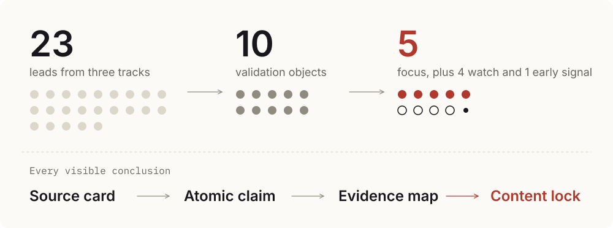
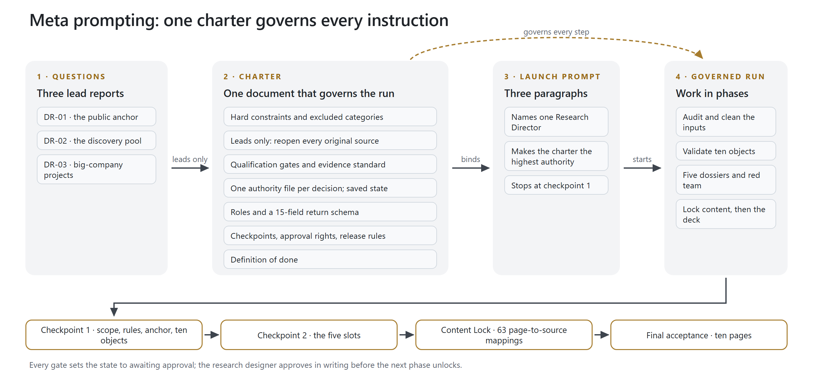

# Manifold 海外世界模型竞争格局

> 一项按决策系统来设计的市场研究：三个研究问题、一份章程、四道审批门，以及从每一句结论回到来源的证据链。\
> 对照版本：[English](./README.en.md)\
> 研究截至 2026-07-14 · 重点对象：World Labs、Odyssey、Runway、Decart 与 NVIDIA Cosmos 3\
> 材料：[10 页演示稿](source-snapshot/archive/manifold-world-model-landscape/10_deck/manifold_world_model_landscape_v1_4.pptx) · [五份 Dossier](source-snapshot/archive/manifold-world-model-landscape/06_dossiers/) · [Evidence Ledger](source-snapshot/archive/manifold-world-model-landscape/04_evidence/evidence_ledger.csv) · [章程](source-snapshot/archive/manifold-world-model-landscape/01_inputs/governance/Manifold_World_Model_Research_Project_Plan_v2.0_CN.md) · [启动 Prompt](source-snapshot/archive/manifold-world-model-landscape/01_inputs/governance/Manifold_ChatGPT_Work_Launch_Prompt_v2.0_CN.md)

**中国以外，谁在做能够行动的世界模型？它们怎样对外交付，又是谁在付费？** 我以 Manifold 这家中国世界模型公司为比较锚点，基于公开来源完成了这项独立研究。研究方法是 Meta Prompting：在任何检索开始之前，我先写好约束所有后续指令的章程，使范围、证据标准和审批权限一次定好，并以同一标准适用于每一个对象。

---

<a id="zh-quick-take" data-pair-id="quick-take"></a>
## 1. 一分钟结论

<a id="zh-quick-take-market" data-pair-id="quick-take-market"></a>
### 1.1 市场是什么样子

1. **供给已经分化为三种交付路径：** 公开计价接口、申请制或受控入口、可下载或自托管组件。
2. **五个重点对象是五条互补的风险路径。** World Labs 代表空间世界产品，Odyssey 代表实时 world stream，Runway 代表内容平台向 Worlds 与 Robotics 延伸，Decart 代表 driving-first 的计价 API，NVIDIA Cosmos 3 代表自托管组件平台。
3. **“可以调用”先于“已经采购”。** 截至 2026-07-14，五个对象最强的公开证据是供应商托管原型、伙伴自报测试、公开计价的供应路径和可下载的模型材料。客户第一方确认的付费生产采用、续约或收入，是下一个证据层级，也是触发重审的事件。
4. **Manifold 是公开比较锚点。** 关于替代与竞争的每一个判断，都以 Manifold 的公开 WorldScape 记录为条件。
5. **下一步是验证与权利基础设施：** 定义标准交付单元；建立动作忠实度、持久状态、几何与碰撞、失败率、延迟和 TCO 的共同验证资产；预先锁定数据、模型改进、部署与再分发权利。

<a id="zh-quick-take-numbers" data-pair-id="quick-take-numbers"></a>
### 1.2 这项研究为什么可以复核

**表 1. 从线索到页面证据映射，研究的各项数量。**

| 环节 | 数量 |
| --- | --- |
| 发现报告登记的对象线索 | 23 |
| 逐一验证的对象 | 10 |
| 重点对象、观察对象、早期信号 | 5、4、1 |
| 登记来源（每个来源一张来源卡） | 141 |
| Evidence Ledger 中的原子主张 | 111 |
| Dossier 定向查询（支持性 28、反证性 30） | 58 |
| 10 页演示稿背后的“页面—主张—来源”映射 | 63 |
| 五席监测信号与观察对象触发器 | 17 与 5 |

<p align="center"></p>

<a id="zh-meta-prompting" data-pair-id="meta-prompting"></a>
## 2. 方法：Meta Prompting

<a id="zh-meta-prompting-what" data-pair-id="meta-prompting-what"></a>
### 2.1 一份关于“指令如何运行”的指令

普通的 Prompt 向模型要一个答案。Meta Prompt 决定答案如何产生：可以检索什么、什么算证据、哪个文件说了算、何时必须停下、谁批准下一步。我先写的是这份文件。研究问题在评判答案的规则定好之后才登场。

<picture>
  <source media="(prefers-color-scheme: dark)" srcset="../../assets/meta-prompting-dark.png">
  
</picture>

<a id="zh-meta-prompting-layers" data-pair-id="meta-prompting-layers"></a>
### 2.2 三层结构

**表 2. Meta Prompt 的三层结构。**

| 层 | 文件 | 作用 |
| --- | --- | --- |
| 问题层 | DR-01、DR-02、DR-03 | 三个互相制衡的问题：Manifold 的公开锚点、非中国玩家发现池、大厂项目与替代路线。三份 Deep Research 报告只作线索 |
| 章程层 | [项目执行计划](source-snapshot/archive/manifold-world-model-landscape/01_inputs/governance/Manifold_World_Model_Research_Project_Plan_v2.0_CN.md) | 20 节，规定硬约束、摄取规则、资格门、证据标准、权威文件、状态与恢复、角色、检查点、放行条件和完成定义 |
| 启动层 | [启动 Prompt](source-snapshot/archive/manifold-world-model-landscape/01_inputs/governance/Manifold_ChatGPT_Work_Launch_Prompt_v2.0_CN.md) | 三段话：指定唯一的 Research Director，把章程立为最高依据，重申硬约束，并要求在检查点 1 暂停 |

启动 Prompt 可以只有三段，是因为所有判断标准都已写在章程里。换一个会话，或在中断之后恢复，读到的是同一份章程和同一个状态文件，并从上一个完成的步骤继续。

<a id="zh-meta-prompting-charter" data-pair-id="meta-prompting-charter"></a>
### 2.3 章程规定了什么

**表 3. 章程规定了什么，每一条款保证了什么。**

| 条款 | 内容 | 保证了什么 |
| --- | --- | --- |
| 硬约束 | 演示稿不超过 10 页；固定五席，3–4 家创业公司加 1–2 个大厂项目；Manifold 只作锚点；六类对象不入池 | 研究范围始终是我批准的范围 |
| 摄取规则 | 三份报告是 lead memo；影响资格、五席或关键数字的主张，一律重新打开原始来源 | 事实建立在一手来源之上 |
| 权威文件 | 每个决策域只有一个权威文件；CSV 与 Markdown 高于其 XLSX、PPTX 派生版本 | 只有一套事实 |
| 状态与恢复 | 状态文件记录阶段、状态、下一步和已批准的检查点；每次恢复先读状态；沉默不构成批准 | 进度是文件里的一个字段 |
| 角色与返回格式 | 一个 Lead 加至多三个并行角色；只有 Lead 写权威文件；每个角色按同样的 15 个字段返回结论、证据、反证和未知 | 并行结果可以逐字段合并和比对 |
| 检查点与决策权限 | 两个研究检查点、Content Lock 和最终验收；建议者与批准者分列，批准权在我 | 判断决定节奏 |
| 放行条件 | Red Team 分三路核验；重大问题关闭后才能锁定内容 | 每一句可见结论都经得起攻击 |
| 完成定义 | 五席获批准、主张可追溯、事实与推断分明、Content Lock 获批准、演示稿不超过 10 页 | “完成”有客观标准 |

<a id="zh-meta-prompting-why" data-pair-id="meta-prompting-why"></a>
### 2.4 为什么有效

- **判断前置。** 资格门、证据阈值和措辞上限在第一次检索之前写定，第十个对象与第一个对象适用同一标准。
- **停止可以执行。** 检查点把“可以继续”变成状态文件里的一个字段；批准先回写，下游工作才解冻。
- **输出可以合并。** 统一的返回格式使并行研究的结果能够逐字段比对，冲突在合并时暴露。
- **取舍由我掌握。** 范围、五席和公开措辞由我批准；工具负责扩大覆盖、恢复来源和重复机械校验。

这样使用，研究工具成为一套系统中的仪器：这套系统可以暂停、可以审计，也可以由另一个人用同样五份输入重新运行。

<a id="zh-research-origin" data-pair-id="research-origin"></a>
## 3. 检索之前的三个问题

我把起步工作拆成三个互相制衡的 Deep Research 问题。三个问题的结构、各自要解决什么、报告此后怎样使用，由我设计。

**表 4. 三份线索报告及由此得到的决定。**

| 报告 | 它带来的价值 | 由此得到的决定 |
| --- | --- | --- |
| [DR-01](<source-snapshot/archive/manifold-world-model-landscape/01_inputs/deep_research/DR-01 Manifold 公开比较锚点.md>) · Manifold 公开比较锚点 | 给出海外对象与 Manifold 相比较的维度 | Manifold 以“公开比较锚点”的身份进入研究，由其公开记录构成 |
| [DR-02](<source-snapshot/archive/manifold-world-model-landscape/01_inputs/deep_research/DR-02 非中国玩家发现池与三层漏斗.md>) · 非中国玩家发现池 | 23 条登记线索，覆盖面远超最知名的几家公司 | 先做对象资格清洗，再做公司研究：“world model”在视频、机器人、仿真和空间智能中的含义各不相同 |
| [DR-03](<source-snapshot/archive/manifold-world-model-landscape/01_inputs/deep_research/DR-03 大厂项目 平台替代与垂直替代路线.md>) · 大厂项目与替代路线 | 大厂通过开放组件或全栈平台形成的绕行路线 | 只有具体的大厂世界模型项目具备资格；VLA、仿真平台和内部组件登记为边界 |

三份报告都只作线索。决定范围、资格和结论的主张，一律重新打开原始公开来源。

<a id="zh-decision-trail" data-pair-id="decision-trail"></a>
## 4. 从 23 条线索到固定五席

<a id="zh-governance-first" data-pair-id="governance-first"></a>
### 4.1 先建立权威文件与状态

执行从三份文件开始：机器可读的[状态文件](source-snapshot/archive/manifold-world-model-landscape/00_brief/project_state.json)、[决策日志](source-snapshot/archive/manifold-world-model-landscape/00_brief/decision_log.md)和[输入登记表](source-snapshot/archive/manifold-world-model-landscape/01_inputs/input_manifest.csv)。五份输入——三份报告加两份治理文件——连同字节数、时间和 SHA256 一并固定。此后我提出的红队意见和批准记录进入同一张登记表。从这里开始，来源之间的每一处分歧都有裁决的位置和裁决的人。

<a id="zh-split-audit" data-pair-id="split-audit"></a>
### 4.2 三份输入分开审计

Manifold 锚点、发现池和大厂路线分开审计，再按同一标准合并。DR-02 的 23 条输入被规范化为 **9 个验证输入、13 个边界排除和 1 个舍弃项**，记录在[资格登记表](source-snapshot/archive/manifold-world-model-landscape/03_universe/eligibility_register.csv)中。前期的大部分工作，是在投入深度研究之前清除范围污染。

<a id="zh-qualification" data-pair-id="qualification"></a>
### 4.3 什么算世界模型对象

厂商使用“world model”一词并不构成资格。资格由三道门决定：

**表 5. 决定对象资格的三道门。**

| 门 | 检验 |
| --- | --- |
| 1 · 验证队列 | 对象值得验证；证据缺口明确标注 |
| 2 · 技术资格 | 动作、控制或持续交互对模型所表示的未来状态产生可审计、时间一致的影响。导航任务中，agent 或相机位姿、可达性、碰撞约束和持续记忆都计入状态 |
| 3 · 战略关系 | 相对于 Manifold 公开锚点，存在潜在产品替代、潜在平台替代，或有证据支持的未来市场竞争 |

应用三道门的同时，每个来源都被重新打开：官方项目页、论文、代码仓库、模型卡、定价页、条款、许可证和合作方原文，逐一建立来源卡。这一阶段把 Overworld 补为第 10 个验证对象，把 Meta 的记录更新到 V-JEPA 2.1，登记了 Manifold 的辅助资产 RoboScape、AirScape 与 Worldscape-MoE，并把 AMI Labs 放入早期信号层。[检查点 1](source-snapshot/archive/manifold-world-model-landscape/05_candidates/checkpoint_1_approval_pack.md) 批准了范围、规则、锚点和十对象验证队列。

<a id="zh-portfolio-selection" data-pair-id="portfolio-selection"></a>
### 4.4 五席是一个组合

技术资格、外部可获得性和商业竞争分开检验。对十个对象逐一记录：动作是否改变模型所表示的未来，主体是否满足地域规则，外部用户怎样获得系统，采用证据由谁报告，对象与锚点是什么关系。

**表 6. 固定五席：代表路径、已成立的事实与重审触发器。**

| 席位 | 代表路径 | 已成立 | 重审触发器 |
| --- | --- | --- | --- |
| **World Labs** | 空间世界产品与 API，加实时导航研究 | RTFM 展示位姿条件未来与空间记忆；Marble 与 World API 公开计价 | 动态交互获得独立复现，或推出版本化的动态交互服务 |
| **Odyssey** | 实时 world-stream 开发者服务 | 历史状态与动作条件未来；文档给出 API key、JS 与 Python 接入和连接规则 | 独立账户在公开价格和 SLA 下完成长期稳定调用 |
| **Runway** | 内容平台向 Worlds 与 Robotics 延伸 | Worlds 有公开申请制 early access；Robotics 描述动作条件 rollout 与部署路径 | 任一组件获得独立调用和伙伴侧生产确认 |
| **Decart** | 公开计价的 driving-first Preview API | 公开账户、0.02 美元/秒、有状态的驾驶动作 | 进入正式商用，SLA、数据与责任条款齐备 |
| **NVIDIA Cosmos 3** | 可下载、自托管的动作条件组件 | 动作条件前向动力学有可运行材料和自托管路径 | 稳定的 action runtime 或 action NIM 发布并获独立复现 |

Runway 占一席，因为它提供公开申请制的产品与应用入口；Genie 3 作为前沿能力和消费者原型进入观察层。四家创业公司加一个大厂项目，使五条路线保持互补，由 Cosmos 3 承载自托管平台风险。[检查点 2](source-snapshot/archive/manifold-world-model-landscape/05_candidates/checkpoint_2_recommendation_pack.md) 固定了 **5 个重点对象、4 个观察对象（Genie 3、MIRA、Meta V-JEPA、Overworld）和 1 个早期信号（AMI Labs）**。

<a id="zh-dossier" data-pair-id="dossier"></a>
## 5. 证据：Dossier、主张与来源

[五份 Dossier](source-snapshot/archive/manifold-world-model-landscape/06_dossiers/) 回答同样的四个问题：一手来源确立了什么，哪些由厂商或伙伴自报，哪些组件必须分开，什么证据一旦出现就会改变判断。分析的最小单元是组件：RTFM 与 Marble、World API 分开，Odyssey-2 Pro 与 Max 分开，Runway Worlds 与 Robotics 分开，Cosmos 的模型与其运行时分开。

每一条可见结论都经过同一条链：

```text
原始来源  →  来源卡  →  原子主张  →  Dossier 与矩阵  →  页面主张  →  Content Lock
```

来源卡记录来源支持什么、留下什么未决问题，以及它的版本或组件边界。一条原子主张只承载一个可判断的事实，因此整篇网页不会替它没有覆盖的句子背书。检索是对称的：58 次定向查询中，28 次寻找支持，30 次寻找反证。证据底座共 **141 个来源、141 张来源卡和 111 条原子主张**，Ledger 含 22 个字段。

<a id="zh-red-team" data-pair-id="red-team"></a>
## 6. Red Team 与 Content Lock

<a id="zh-red-team-lines" data-pair-id="red-team-lines"></a>
### 6.1 四个维度比较，三条路线攻击

五个对象在技术证据、外部可获得性、商业采用上限和对 Manifold 的条件性意义四个维度上比较，[矩阵](source-snapshot/archive/manifold-world-model-landscape/07_synthesis/competitive_matrix.csv)保留各自的差异。随后 [Red Team](source-snapshot/archive/manifold-world-model-landscape/09_red_team/red_team_report.md) 从三条路线攻击结果：技术来源与版本；商业访问、许可与采用措辞；范围与叙事。它把战略关系门确定为相对于公开锚点的条件性比较，把试点和 hands-on 的措辞收到来源所能支持的位置，并形成 **17 个五席监测信号和 5 个观察对象触发器**。

<a id="zh-content-lock" data-pair-id="content-lock"></a>
### 6.2 Content Lock

每一句可见文字都拆成 `Page Claim → Atomic Claim → Source` 映射，以 CSV 为权威形式，并由它生成审阅工作簿。Content Lock 冻结内容稿、映射、工作簿和 Ledger 及其哈希。它把 Cosmos3-Generator NIM 确定为官方 Release 1.0.0，把 Odyssey 的 150 秒、60 分钟和 15 分钟区分为三条不同的运营规则，并为每个对象建立独立的证据行。锁定的结果是 **63 条唯一页面证据映射，覆盖 10 个内容单元**，见[页面证据映射](source-snapshot/archive/manifold-world-model-landscape/08_content/slide_evidence_map.csv)。

<a id="zh-deck" data-pair-id="deck"></a>
## 7. 演示稿

内容锁定之后，研究结论转成 10 页 Storyboard 和 [PowerPoint 演示稿](source-snapshot/archive/manifold-world-model-landscape/10_deck/manifold_world_model_landscape_v1_4.pptx)。叙事从市场变化出发，经玩家分化、五席差异、逐对象验证和观察层，落到 Manifold 的行动。演示稿在 Microsoft PowerPoint 中以 1280×720 渲染；252 个文本框通过边界检查，每一页都以全尺寸和缩略图复看。锁定之后变化的是版式，事实不变。

<a id="zh-conclusions" data-pair-id="conclusions"></a>
## 8. 结论

海外世界模型已经从演示走向三种交付路径：**公开计价接口、申请制或受控入口、可下载或自托管组件**。竞争单位从视觉质量扩大到接口、运行时、部署、集成、数据权、许可和总体拥有成本。

市场已经可以调用；客户确认的付费生产采用，是它前面的下一个证据层级。对 Manifold，这意味着三项行动：

1. **定义标准交付单元**：模型、API、部署服务和联合项目分别交付什么，哪些层由 Manifold 拥有、集成或采购。
2. **建立共同验证资产**：动作忠实度、持久状态、几何与碰撞、失败率、延迟和总体拥有成本。
3. **锁定权利边界**：输入输出数据权、模型改进权、部署范围和再分发规则，在商业规模到来之前确定。

五类可审计事件会触发重审：有公开价格和 SLA 的稳定接口、独立复现、商用条款闭合、客户第一方采用、稳定的动作产品。完整表述见[最终结论](source-snapshot/docs/overview/final-conclusions.md)、[固定五席](source-snapshot/docs/results/final-five.md)与[观察名单](source-snapshot/docs/results/watchlist.md)。

<a id="zh-postmortem" data-pair-id="postmortem"></a>
## 9. 可以带走的设计规则

1. **拆开起始问题。** 锚点、发现池和替代路线图互相校验。
2. **区分四种判断：** 值得调查、技术合格、具有战略关系、值得占席。
3. **把支持证据、反证和未知写进同一套系统，** 使红队能够改变结论。
4. **在执行与公开主张之间放置检查点和 Content Lock。**
5. **在第 0 天同时设计交付层和审计层。**
6. **把审批写成可执行的状态。** “检查通过”和“已经批准”是两个字段。
7. **用关闭的风险和避免的遗漏衡量方法的价值。**

<a id="zh-audit" data-pair-id="audit"></a>
## 10. 如何复核这项研究

沿着决策链阅读：

1. 阅读[章程](source-snapshot/archive/manifold-world-model-landscape/01_inputs/governance/Manifold_World_Model_Research_Project_Plan_v2.0_CN.md)、[启动 Prompt](source-snapshot/archive/manifold-world-model-landscape/01_inputs/governance/Manifold_ChatGPT_Work_Launch_Prompt_v2.0_CN.md) 和 [`01_inputs/deep_research/`](source-snapshot/archive/manifold-world-model-landscape/01_inputs/deep_research/) 中的三份线索报告；
2. 对照[输入登记表](source-snapshot/archive/manifold-world-model-landscape/01_inputs/input_manifest.csv)与[资格登记表](source-snapshot/archive/manifold-world-model-landscape/03_universe/eligibility_register.csv)；
3. 抽查[来源登记](source-snapshot/archive/manifold-world-model-landscape/04_evidence/sources.csv)、来源卡和 [Evidence Ledger](source-snapshot/archive/manifold-world-model-landscape/04_evidence/evidence_ledger.csv)；
4. 阅读[五份 Dossier](source-snapshot/archive/manifold-world-model-landscape/06_dossiers/) 和[横向比较](source-snapshot/archive/manifold-world-model-landscape/07_synthesis/cross_comparison.md)；
5. 对照[决策日志](source-snapshot/archive/manifold-world-model-landscape/00_brief/decision_log.md)阅读 [Red Team 报告](source-snapshot/archive/manifold-world-model-landscape/09_red_team/red_team_report.md)；
6. 运行机械审计：

```powershell
powershell -ExecutionPolicy Bypass -File source-snapshot/scripts/audit/verify_repository.ps1
```

脚本核对五份输入、141 个来源与来源卡、111 条主张、58 次查询、63 条映射和演示稿的 SHA256。

来源登记中的核心一手入口：

- [Manifold WorldScape](https://manifoldai.cn/blogs/WorldScape.html)
- [World Labs](https://www.worldlabs.ai/about)
- [Odyssey](https://odyssey.ml/the-gpt-2-moment-for-world-models)
- [Runway GWM-1](https://runwayml.com/research/introducing-runway-gwm-1)
- [Decart Oasis](https://decart.ai/oasis)
- [NVIDIA Cosmos 3](https://research.nvidia.com/labs/cosmos-lab/cosmos3/)
