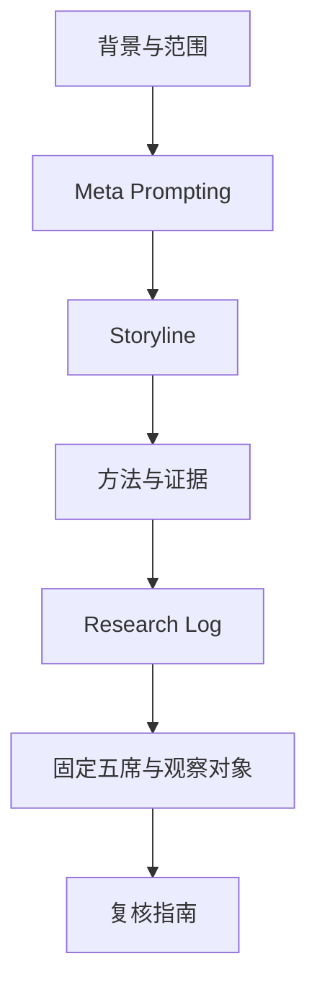

# Manifold 海外世界模型竞争格局

这是一套可以逐条复核的研究材料：输入、资格判断、来源、主张、反证、审批记录和最终演示稿。

它回答的不是“谁的 Demo 最好看”，而是：在非中国世界模型创业公司和非中国大厂具体项目中，哪些对象已经形成可审计的动作条件世界模型路径，它们通过什么方式被外部获得，可能怎样影响 Manifold，哪些关键事实仍未成立。

## Executive Answer

海外世界模型已经从模型演示走向三种交付方式：

1. 公开计价接口；
2. 申请制或受控入口；
3. 可下载、自托管组件。

但截至 2026-07-14，公开证据尚不足以证明固定五席中的任何对象已经达到客户第一方确认的付费生产采用。

## 固定五席

- World Labs
- Odyssey
- Runway
- Decart
- NVIDIA Cosmos 3

这五席代表五种互补的产品和平台路径，不构成能力、公司或商业成熟度排名。

## 推荐阅读路径

- 背景与范围：[背景与研究问题](overview/background.md)、[范围与硬约束](overview/scope.md)
- Meta Prompting：[Meta Prompting](methodology/meta-prompting.md)
- Storyline：[研究 Storyline](storyline/storyline.md)、[完整工作流](storyline/workflow.md)、[任务依赖关系图](storyline/dependency-graph.md)、[思维导图](storyline/mind-map.md)
- 方法与证据：[研究方法](methodology/research-method.md)、[准入门与范围清洗](methodology/qualification-gates.md)、[证据模型](methodology/evidence-model.md)、[验证与 Red Team](methodology/validation-red-team.md)
- Research Log：[时间线](research-log/timeline.md)、[检查点记录](research-log/checkpoints.md)、[重要决策与理由](research-log/decision-rationale.md)
- 固定五席与观察对象：[最终结论](overview/final-conclusions.md)、[候选漏斗](results/candidate-funnel.md)、[固定五席](results/final-five.md)、[观察对象和早期信号](results/watchlist.md)、[对 Manifold 的行动建议](results/strategic-actions.md)
- 复核指南：[复核指南](reproducibility/reproduction-guide.md)、[材料地图](reproducibility/repository-map.md)

研究方法的核心是 [`Meta Prompting`](methodology/meta-prompting.md)：先写约束研究过程的章程，再用三段话的启动 Prompt 启动它。

五份对象研究为 [`01 World Labs`](../archive/manifold-world-model-landscape/06_dossiers/O-001_world_labs_dossier.md)、[`02 Odyssey`](../archive/manifold-world-model-landscape/06_dossiers/O-002_odyssey_dossier.md)、[`03 Runway`](../archive/manifold-world-model-landscape/06_dossiers/O-003_runway_dossier.md)、[`04 Decart`](../archive/manifold-world-model-landscape/06_dossiers/O-004_decart_dossier.md) 和 [`05 NVIDIA Cosmos 3`](../archive/manifold-world-model-landscape/06_dossiers/O-005_nvidia_cosmos_3_dossier.md)；研究协议、查询审计和完成 QA 单独存放在 `06_dossier_support/`。

## 证据规模

- 141 个来源登记；
- 141 张来源卡；
- 111 条原子主张；
- 5 份 dossier；
- 58 次定向查询；
- 63 条页面证据映射；
- 17 条固定五席监测信号；
- 5 条观察对象触发器。

## 关键边界

Manifold 仅作为 WorldScape / WorldScape Policy 的公开比较锚点。所有产品替代、平台替代和未来市场竞争判断均为相对于公开锚点的条件性分析，不证明现实客户、预算或采购位置已经重合。
